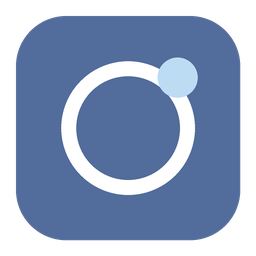

# Orbit Desk



A customized macOS desktop proxy client based on [Clash Verge Rev](https://github.com/clash-verge-rev/clash-verge-rev). This is an independent source snapshot with updated application branding and identifiers.

## Download

**[Download for macOS — Apple Silicon (M-series)](https://github.com/xzljq/orbit-desk/releases/download/v2.5.9-orbit.1/OrbitDesk-macOS-arm64.zip)**

Extract the ZIP and move **Orbit Desk.app** to **Applications**. This binary is for **arm64 Macs**, not Intel Macs. It uses a local ad-hoc signature and is not notarized by Apple.

See the [release page](https://github.com/xzljq/orbit-desk/releases/tag/v2.5.9-orbit.1) for corresponding source archives and SHA-256 checksums.

## Changes

- Application name and icon: **Orbit Desk**.
- Application Bundle ID: `local.orbitdesk.client`.
- Main executable: `orbit-desk`.
- Service and installer executables use the `orbit-desk-service` prefix.
- Core executables: `orbit-core` and `orbit-core-alpha`.
- Saved upstream core selection values are mapped to these executable names. The original subscription URL schemes remain supported.

The application keeps the upstream proxy interface and workflows. Existing user data is not migrated automatically to the new application data directory. No subscription credentials or user profiles are included.

The upstream application updater remains configured. Installing an official upstream application update can replace this customized build and its identifiers. Rebuild this source to retain the customization.

## Build

On macOS, install Xcode build tools, Node.js 24, pnpm, and the Rust toolchain specified in `rust-toolchain.toml`.

```sh
pnpm install --frozen-lockfile
bash scripts/build-orbit-macos.sh
```

The script prepares upstream cores and geographic databases, compiles the locally included service source, and produces an app bundle for the native Rust host architecture. It removes release debug information and remaps build-machine paths. It does not install or launch the app.

The app is written under `target/<host-target>/release/bundle/macos/` unless `CARGO_TARGET_DIR` is set. Network proxy settings can be supplied through `HTTP_PROXY`, `HTTPS_PROXY`, and `CARGO_HTTP_PROXY`.

Upstream GitHub Actions workflow definitions and policy files are excluded from this distribution snapshot. The local build scripts are included; repository Actions are disabled.

## Validation

The corresponding customized source passed 155 targeted Rust tests: 100 service library tests, 22 service-tool tests, and 33 application tests. One service benchmark was ignored. Five frontend tests, frontend production compilation, Rust formatting, and scoped Clippy checks also passed.

The macOS application bundle and bundled service tools were checked for signature integrity. These checks do not establish real-world subscription connectivity, TUN behavior, or compatibility with endpoint security products.

## Source and licenses

The original licenses and author attributions are retained. The main application is licensed under [GPL-3.0-only](LICENSE); the included service retains its [upstream license](vendor/service/LICENSE).

| Component | Source revision |
| --- | --- |
| Clash Verge Rev 2.5.9 | [`eefd025806f255b85e7bc28158c30fdad477935d`](https://github.com/clash-verge-rev/clash-verge-rev/commit/eefd025806f255b85e7bc28158c30fdad477935d) |
| Service IPC 2.7.6 | [`b2a7427d6681c8d3780ab83a73f4dc21da2f22d6`](https://github.com/clash-verge-rev/clash-verge-service-ipc/commit/b2a7427d6681c8d3780ab83a73f4dc21da2f22d6) — customized source is in `vendor/service` |
| Mihomo v1.19.33 | [`3f27ef39f8c96bbfbc8b0b9bb10f5c9ef60149d8`](https://github.com/MetaCubeX/mihomo/commit/3f27ef39f8c96bbfbc8b0b9bb10f5c9ef60149d8) |
| Mihomo alpha-b6a1518 | [`b6a15182c2870f42eb04df7b763171fd3e2f1da4`](https://github.com/MetaCubeX/mihomo/commit/b6a15182c2870f42eb04df7b763171fd3e2f1da4) |

Both Mihomo cores are upstream implementations packaged under different executable names and locally signed. Corresponding core source archives are provided alongside the application in Releases. Upstream build information is preserved in those archives.

This project is not an official release of Clash Verge Rev or Mihomo. The [upstream application README](docs/UPSTREAM_README.md) is preserved for provenance.
